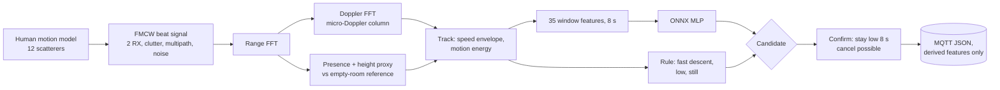

# radar-fall-detector

> **Research demo, not a medical device.** It has not been tested on real people or a real radar, makes no
> medical or safety claims, and must not be relied on to detect falls.

Camera-free fall detection for elderly-care rooms with a 60 GHz FMCW radar: a simulated radar, the full signal
chain (range FFT, Doppler FFT, micro-Doppler, features), a small ONNX classifier plus a rule-based check,
an alarm with a confirmation window and cancel option, and MQTT output of derived features only. Everything
below is measured on **simulated** data.


<sub>Simulated 60 GHz radar, seeded. Top left: a fall. Top middle: sitting down fast. Green: height proxy from the
elevation phase of two RX channels.</sub>

## What it does

* **Simulates** a 60 GHz FMCW radar (2 GHz-class chirps, 2 RX) watching a room: a 12-scatterer human model
  (walking, sitting, lying on a bed, bending, squatting, seven kinds of fall), room clutter, a swaying curtain,
  floor and wall multipath, LO phase jitter and thermal noise. Parameters: [docs/SIMULATION.md](docs/SIMULATION.md).
* **Processes** each 20 Hz frame: range FFT, Doppler FFT, clutter removal against an empty-room reference,
  gating, micro-Doppler profile (one STFT column per frame), velocity envelope, a height proxy from the
  elevation phase, and presence.
* **Decides** with (a) a small MLP on 35 window features, exported to ONNX, and (b) a rule: *fast descent, then
  low, then still*. Either can raise a candidate; the alarm needs the person to stay on the floor for a
  confirmation window, and a carer or the person can cancel.
* **Publishes** MQTT JSON (`radar-fall/<device>/event`) with a few derived numbers. Raw radar data never leaves
  the process (see [Privacy](#privacy-by-design)).

## Results (simulated data, seeded, full run)

Test set: 210 simulated falls (7 kinds, 30 each, unseen seeds) and 8.0 h of simulated fall-free daily living
(239 fall-like events: sitting, bed, bending, squatting, sitting on the floor, stumbles). The ML threshold (0.5)
was chosen on a separate validation set. Window-level AUC of the MLP: 0.998 (gradient boosting 0.9997).

| Mode | Falls alarmed | False alarms in 8 h | Per day (extrapolated) | Median alarm latency |
|---|---|---|---|---|
| Rule only | 89.0 % | 11 | 33 | 8.1 s |
| ML only | 98.6 % (207/210) | 14 | 42 | 8.6 s |
| Rule or ML | 98.6 % (207/210) | 17 | 51 | 8.2 s |

**The false-alarm rate is too high for any real use.** 33 to 51 alarms per day would be rejected by any carer. In
the ML mode they come from sitting normally (4), sitting on the floor (4), fast sitting (2), bending (1),
squatting (1), a stumble (1) and one with no labelled event; sitting on the floor is partly a labelled ambiguity
(a person who sits down on the floor and stays there looks like a fall to a height-and-stillness rule). The
number is extrapolated from only 8 h, so the per-day figure is coarse (one alarm is about 3 per day). I did not
tune the detector on the test set to hide this.

Robustness (42 falls per point): sensitivity is 100 % at 30 dB SNR, 86 % at 20 dB, 52 % at 15 dB and 24 % at 10 dB;
by position it is 95 to 98 % from -25 to +25 degrees off boresight, 79 % at -50 and 88 % at +50 degrees; falls facing
the radar at 0, 45 or 90 degrees all reach 100 %.

Edge cost (one thread of a 2013 Intel Core i5-4210U): about 2.2 ms of DSP per 50 ms frame, 1.5 ms of features and
0.14 ms of ONNX inference per window, model file 7.4 KB. This is a laptop CPU, not a microcontroller.


## Quick start

```bash
python -m venv .venv && . .venv/bin/activate        # Windows: .venv\Scripts\activate
pip install -r requirements-dev.txt
python -m pytest -p no:asyncio -q                    # unit tests
python -m radarfall demo --quick                     # ~5 min smoke run, writes to data/quick/
python -m radarfall demo                             # full run: reproduces the numbers above (about 1 h on 4 cores)
python -m radarfall sim --kind backward --seed 3     # one simulated fall -> MQTT JSON on stdout (uses models/fall_mlp.onnx)
python -m radarfall sim --kind forward --mqtt localhost:1883   # publish to a real broker
```

The full run is deterministic (seeded). It simulates about 28 hours of radar time and caches it in `data/cache/`.
Committed outputs of the full run: `results/results.json`, `models/fall_mlp.onnx`, `docs/*.png`.

## How it works



* `radarfall/radar.py` synthesises the IF signal; `dsp.py` is the signal chain; `features.py` builds the window
  features; `detector.py` is the streaming state machine (idle, confirming, alarmed); `edge.py` the MQTT part.
* **Height proxy.** Two RX channels stacked vertically give the elevation angle of the power-weighted reflections,
  so a standing person reads about 1 m and a person on the floor about 0.1 m. It is a proxy, not a measurement of
  body height.
* **Clutter.** An empty-room reference (taken at install) is subtracted, so a person lying *perfectly still* is
  still visible through the static reflection change, while a swaying curtain is learned as an unstable range bin
  and masked.
* **Alarm logic.** Candidate -> `fall_suspected` (local prompt, "press to cancel") -> the person must stay low for
  `confirm_s` = 8 s -> `fall_alarm`. Standing up again, or leaving, clears it. After an alarm the detector is
  latched until the person is upright again, so one fall gives one alarm. `cancel()` works while confirming and
  for 5 s after the alarm; on the device it is wired to the MQTT topic `radar-fall/<device>/cancel`.

### Privacy by design

No camera, no audio, no wearable. The radar sees reflections, not faces. On the device the raw ADC data, the
range-Doppler maps and the spectrograms exist only in memory for one frame or one 8 s window. The only thing sent
is this document (about 300 bytes) at a suspected fall, an alarm, a clear or a cancel:

```json
{"schema": "radar-fall/1", "device_id": "radar-01", "ts": "2026-11-08T21:14:03Z",
 "event": "fall_alarm", "source": "ml", "score": 0.99, "t_stream_s": 31.4,
 "features": {"z_end_m": 0.11, "peak_speed_ms": 3.4, "still_fraction": 0.95},
 "notice": "research demo, not a medical device"}
```

This is an engineering note on data minimisation (Swiss nFADP, privacy by design and by default), not legal advice
and not a compliance claim.

## Data sources

Simulation only; there is no external data. I did not evaluate on a public radar fall dataset: I did not verify
that any such dataset's licence allows redistributing derived results, so none is used.

## What is not verified yet

* Everything is **simulated**. No real radar, no real person, no care-home trial. The simulator shares the author's
  assumptions with the detector, so real-world performance will be worse, possibly much worse.
* **False alarms are high** (see Results). Reducing them needs real data of everyday activity.
* Only one person in an empty room, one radar position. No pets, no second person, no fans or moving curtains
  beyond the one modelled.
* The height proxy comes from a 2-RX elevation phase; a real 2-RX board would have different calibration and
  multipath. Fall kinds and their timing are my own models, not clinical recordings.
* The detector sees a fall only when the person ends up low and still; a fall onto a bed or chair may be missed.
* Not a medical device, no regulatory work, no safety claim, no privacy or legal assessment.

## Licence

MIT, Copyright (c) 2026 Victor Bonilla. Dependencies are used, not copied: numpy, scipy-free DSP, scikit-learn,
onnx, onnxruntime, paho-mqtt, matplotlib.
